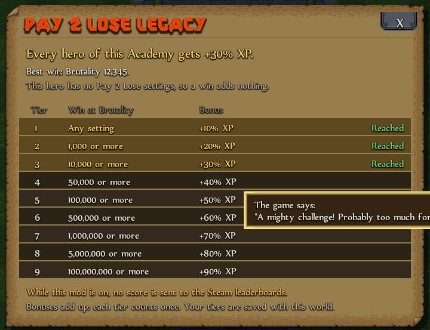

# Pay 2 Lose legacy

In the base game, Pay 2 Lose settings only give you a Brutality score for the Steam leaderboards. With this mod, they also give XP to your Academy's heroes.

## How it works

- Pick Pay 2 Lose settings for a hero, then **beat the game** (kill the Final Foom).
- You get **+10% XP** for each Brutality tier you reach for the first time. The bonus starts right after the winning kill, and every later hero of this Academy gets it too.
- There are 9 tiers, so the most you can get is **+90% XP**. They follow the comments the game shows under your Brutality score: any setting, 1,000, 10,000, 50,000, 100,000, 500,000, 1 million, 5 million and 100 million.
- Winning again at the same or a lower Brutality adds nothing. Your tiers are saved with the world.
- When a new hero starts, the log shows the current bonus.

## The P2L window

Click **P2L** in the bar at the top of the screen. The window shows your bonus, your best win, which tiers you have, and what a win with your current hero would add. Hover a tier to see the game's comment for it.

The game's own Pay 2 Lose menu also gets one line at the bottom of its Summary page. It tells you which tier a win with those settings would reach.

## Leaderboards

While this mod is on, **no score is sent to the Steam leaderboards**, because the extra XP would make the scores unfair. If you turn the mod off in Mod Settings, the bonus stops and scores are sent again. The tiers you earned stay saved.
